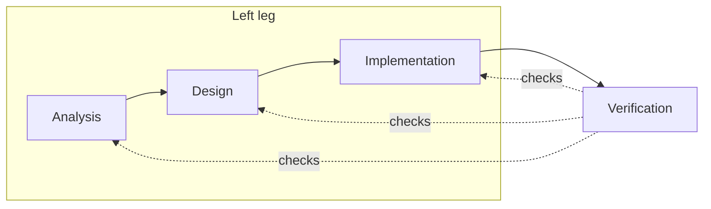

# playground-notes-app

A notes application built to practise a specification-driven, test-first method: a mini V-cycle with BDD and TDD, DDD, and a hexagonal (ports and adapters) architecture.

## Principles

1. **One owner per fact.** Every statement lives in exactly one artifact. Others refer to it by ID and do not paraphrase it.
2. **References point upstream.** A downstream artifact names the upstream artifact it realizes. Upstream artifacts do not list their dependents.
3. **One language.** Terms follow the Ubiquitous Language (UL-NOTE-001).
4. **The ontology is the single source of truth for domain meaning:** concepts, relationships, rules, and lifecycle. Interaction is owned by the use case and design by the design specification. Both cite the ontology and never restate it.

These are responsibility boundaries, not phases. The artifacts are different views of one system, so you will revisit earlier ones as you learn. The stages below order the *delivery* of a use case. They do not make one artifact depend on finishing another.

## Where information belongs

When a new statement turns up, ask what kind it is. It belongs to the one owner in the right column. Everything else cites it by ID.

| Kind of statement | Owner | Example |
|---|---|---|
| A stakeholder need, and how to tell it is met | Requirement (acceptance criteria) | Users must be able to archive Notes |
| A domain truth: what exists and what is always true | Ontology | A Note is Active, Archived or Deleted |
| A condition the aggregate must protect that the ontology cannot express | Domain invariant (`INV`) in the design specification | |
| An interaction: steps and failure flows | Use case | Archiving a Note, step by step |
| How software represents and enforces a truth | Design specification | `Note.archive()` controls the transition |
| A structural choice with a reason | ADR | Ports are `typing.Protocol` classes |
| A way to check a fact | Test, citing the criterion or rule it checks | Archived Notes keep their Content |

A use case postcondition or a test that restates a domain rule is duplication. It cites the rule instead. Tests verify facts and never own them.

### The ontology

The ontology is persistent. It is written once per bounded context and grows across use cases, so a new use case adds only what it needs and does not recreate the model.

- **Scope: one ontology per bounded context.** A shared project-wide model would blur terms that mean different things in different contexts.
- **Growth: on demand.** Model a concept when a use case needs it, not when you first think of it. Unused concepts cannot be told apart from exercised ones.
- **In a use case it is a lookup, then an extension.** Check whether each noun, relationship and rule exists. Add only what is missing. Nothing may cite an ID before it exists.

## Changing something upstream

When Implementation or Verification shows that an upstream artifact is wrong, fix its owner and not the symptom.

1. Find what cites it: `uv run --with rdflib tools/traceability.py --impact <ID>`.
2. Change the owning artifact, and regenerate the generated views.
3. Revisit each artifact the impact query listed, and each test that carries the ID.
4. Run `uv run tools/check.py`. For a card in Verification, run `uv run tools/check.py --verify`.

An ID is stable. If a rule's meaning changes, change its text and review its citers. If it is replaced by a different rule, retire the old ID and never reuse it.

## Naming

An artifact ID is `<TYPE>-<DOMAIN>-<NUMBER>`, or `<TYPE>-<SUBTYPE>-<DOMAIN>-<NUMBER>` for types with subtypes. Records that are not tied to a domain omit it (`ADR-001`).

| Artifact | Prefix | Example |
|---|---|---|
| Functional requirement | `REQ-FR` | `REQ-FR-NOTE-001` |
| Non-functional requirement | `REQ-NFR` | `REQ-NFR-NOTE-001` |
| Use case | `UC` | `UC-NOTE-001` |
| Ubiquitous language | `UL` | `UL-NOTE-001` |
| Ontology concept | `ONT` | `ONT-NOTE-001` |
| Ontology relationship | `ONT-REL` | `ONT-REL-NOTE-001` |
| Ontology rule | `ONT-RULE` | `ONT-RULE-NOTE-001` |
| Domain invariant | `INV` | `INV-NOTE-001` |
| Architecture decision | `ADR` | `ADR-001` |
| Design specification | `DES` | `DES-NOTE-001` |
| Test case | `TC` | `TC-NOTE-001` |
| Test suite | `TS` | `TS-NOTE-001` |
| Defect | `BUG` | `BUG-NOTE-001` |

An ontology rule (`ONT-RULE`) is a structural truth about a concept. A domain invariant (`INV`) is a condition the aggregate must protect that the ontology cannot express, and it refers to the ontology rule it relates to and never restates it.

**Files.** Analysis and design diagrams are named `analysis-` or `design-` followed by `<use case id>-<slug>-<kind>.puml`, where kind is `sequence`, `class` or `activity`, and sit beside their use case. A document that holds one artifact is named `<id>-<slug>`, in lowercase (`uc-note-001-create-note.md`). A document that holds many artifacts has a plain name (`functional-requirements.md`, `ont-note.ttl`).

## Who owns what

| Artifact | Owns | Path |
|---|---|---|
| Functional requirements | What the User needs, with Gherkin acceptance criteria | docs/requirements/functional-requirements.md |
| Non-functional requirements | Quality needs | docs/requirements/non-functional-requirements.md |
| Ontology | What exists and what is always true of it: concepts, relationships, rules, lifecycle | docs/ontology/ont-note.ttl (diagrams generated beside it) |
| Use cases | Interaction: steps and failure flows | docs/use-cases/ |
| Analysis diagrams | Views of one use case: sequence, concepts involved, activity only when needed | docs/use-cases/analysis-* |
| Ubiquitous language | How we talk | docs/architecture/ul-note-001-ubiquitous-language.md |
| Design specification | Aggregates, entities, value objects, what enforces each ontology rule, and which tests cover each acceptance criterion | docs/architecture/des-note-001-note-aggregate.* |
| Design diagrams | Views of one use case: sequence and classes (application and adapters) | docs/use-cases/design-* |
| Architecture decisions | Layers, ports, adapters, dependency rule, backend layout | docs/architecture/adr/ |
| Context map | Bounded contexts and how they relate | docs/architecture/ddd-context-map.puml |
| Kanban | Where each use case stands | docs/kanban.md |
| Traceability matrix and diagram | Generated views of how rules, criteria, use cases, design, and tests connect, and where they do not | docs/traceability.md, docs/traceability.puml |

## Diagrams

| Use | Format | Example |
|---|---|---|
| A reviewed artifact that others cite: analysis diagrams, design specification, context map | PlantUML, in its own file | `analysis-uc-note-001-create-note-sequence.puml` |
| An illustration of the point a document is making | Mermaid, inline in the Markdown | The V-cycle sketch below |
| A view of the ontology | Generated PlantUML, committed with a "do not edit" header | `ont-note-class.puml`, `ont-note-state.puml` |

The generated ontology diagrams show every concept, relationship, and the status lifecycle. Regenerate them after changing the ontology, and check that they are current:

```
uv run --with rdflib tools/ontology_to_puml.py          # write
uv run --with rdflib tools/ontology_to_puml.py --check  # fail if out of date
uv run --with rdflib --with pyshacl tools/check_ontology.py  # lint, constraints, competency questions
uv run --with rdflib tools/traceability.py              # write docs/traceability.md and .puml
uv run --with rdflib tools/traceability.py --check      # fail if out of date or an unknown ontology ID is cited
```

One command runs every check and is the gate for each Kanban exit check:

```
uv run tools/check.py           # Analysis and Design gate: spec, diagrams, traceability
uv run tools/check.py --verify  # Verification gate: also tests for every criterion, the test suites, and the dependency rule
```

An inline Mermaid diagram is illustrative and never authoritative. It must not restate a rule, flow, or structure that another artifact owns. If a fact appears only in a Mermaid diagram, move it to its owner.

## Procedure for each use case

A use case moves across the Kanban one stage at a time. A stage is finished when its exit check passes. The steps for each stage are skills, kept in `.agents/skills/` (and visible to Claude Code through `.claude/skills`):

- `ontology-authoring`: change the ontology, run its checks, and regenerate its diagrams
- `use-case-analysis`: requirement, ontology, language, use case, and analysis diagrams
- `use-case-design`: domain model, ports, decisions, and test mapping
- `use-case-implementation`: tests first (BDD, then TDD), then code inside the hexagonal layout
- `use-case-verification`: run every check, close gaps, and close the card

### Implementation and Verification

See the two skills above. In short: write the tests first, then the code, then run every check. The use case is done when its acceptance criteria pass at every level the design mapped.

## Mini V-cycle



The table is the authoritative description. The diagram only shows the shape.

Each stage on the left has a matching check on the right.

| Stage | Produces | Verified by |
|---|---|---|
| Analysis | Requirements, ontology, use cases, language | Acceptance tests: the Gherkin criteria, run as BDD scenarios. System tests: one per use case flow, through a driving adapter. |
| Design | Domain model, ports, adapters | Integration tests: each adapter against its port |
| Implementation | Code, written test-first | Unit tests (TDD) of the domain and application layers |
| Verification | | Runs the checks above and closes the use case |

A use case moves across the Kanban stage by stage and is done when its acceptance criteria pass.
