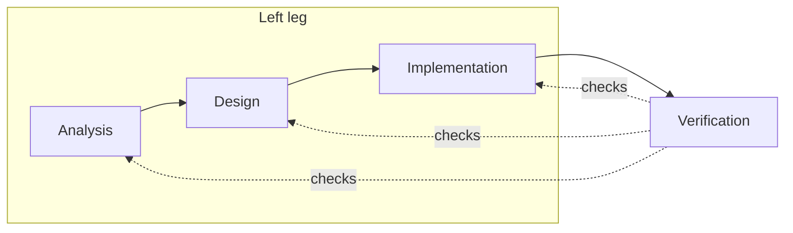

# playground-notes-app

A notes application built to practise a specification-driven, test-first method: a mini V-cycle with BDD and TDD, DDD, and a hexagonal (ports and adapters) architecture.

## Principles

1. **One owner per fact.** Every statement lives in exactly one artifact. Others refer to it by ID and do not paraphrase it.
2. **References point upstream.** A downstream artifact names the upstream artifact it realizes. Upstream artifacts do not list their dependents.
3. **One language.** Terms follow the Ubiquitous Language (UL-NOTE-001).
4. **The ontology is the single source of truth for domain meaning:** concepts, relationships, rules, and lifecycle. Interaction is owned by the use case and design by the design specification. Both cite the ontology and never restate it.

## Naming

An artifact ID is `<TYPE>-<DOMAIN>-<NUMBER>`, or `<TYPE>-<SUBTYPE>-<DOMAIN>-<NUMBER>` for types with subtypes. Records that are not tied to a domain omit it (`ADR-001`).

| Artifact | Prefix | Example |
|---|---|---|
| Functional requirement | `REQ-FR` | `REQ-FR-NOTE-001` |
| Non-functional requirement | `REQ-NFR` | `REQ-NFR-NOTE-001` |
| Use case | `UC` | `UC-NOTE-001` |
| Ubiquitous language | `UL` | `UL-NOTE-001` |
| Ontology concept | `ONT` | `ONT-NOTE-001` |
| Ontology relationship | `ONT-REL` | `ONT-REL-NOTE-001` |
| Ontology rule | `ONT-RULE` | `ONT-RULE-NOTE-001` |
| Domain invariant | `INV` | `INV-NOTE-001` |
| Architecture decision | `ADR` | `ADR-001` |
| Design specification | `DES` | `DES-NOTE-001` |
| Test case | `TC` | `TC-NOTE-001` |
| Test suite | `TS` | `TS-NOTE-001` |
| Defect | `BUG` | `BUG-NOTE-001` |

An ontology rule (`ONT-RULE`) is a structural truth about a concept. A domain invariant (`INV`) is a condition the aggregate must protect that the ontology cannot express, and it refers to the ontology rule it relates to and never restates it.

**Files.** Analysis and design diagrams are named `analysis-` or `design-` followed by `<use case id>-<slug>-<kind>.puml`, where kind is `sequence`, `class` or `activity`, and sit beside their use case. A document that holds one artifact is named `<id>-<slug>`, in lowercase (`uc-note-001-create-note.md`). A document that holds many artifacts has a plain name (`functional-requirements.md`, `ont-note.ttl`).

## Who owns what

| Artifact | Owns | Path |
|---|---|---|
| Functional requirements | What the User needs, with Gherkin acceptance criteria | docs/requirements/functional-requirements.md |
| Non-functional requirements | Quality needs | docs/requirements/non-functional-requirements.md |
| Ontology | What exists and what is always true of it: concepts, relationships, rules, lifecycle | docs/ontology/ont-note.ttl |
| Use cases | Interaction: steps and failure flows | docs/use-cases/ |
| Analysis diagrams | Views of one use case: sequence, concepts involved, optionally activity | docs/use-cases/analysis-* |
| Ubiquitous language | How we talk | docs/architecture/ul-note-001-ubiquitous-language.md |
| Design specification | Aggregates, entities, value objects, what enforces each ontology rule, and which tests cover each acceptance criterion | docs/architecture/des-note-001-note-aggregate.* |
| Design diagrams | Views of one use case: sequence and classes (application and adapters) | docs/use-cases/design-* |
| Architecture decisions | Layers, ports, adapters, dependency rule, backend layout | docs/architecture/adr/ |
| Context map | Bounded contexts and how they relate | docs/architecture/ddd-context-map.puml |
| Kanban | Where each use case stands | docs/kanban.md |

## Diagrams

| Use | Format | Example |
|---|---|---|
| A reviewed artifact that others cite: analysis diagrams, design specification, context map | PlantUML, in its own file | `analysis-uc-note-001-create-note-sequence.puml` |
| An illustration of the point a document is making | Mermaid, inline in the Markdown | The V-cycle sketch below |
| A view of the ontology | Generated PlantUML | The lifecycle state diagram |

An inline Mermaid diagram is illustrative and never authoritative. It must not restate a rule, flow, or structure that another artifact owns. If a fact appears only in a Mermaid diagram, move it to its owner.

## Procedure for each use case

A use case moves across the Kanban one stage at a time. A stage is finished when its exit check passes. The steps for Analysis and Design are skills, kept in `.agents/skills/` (and visible to Claude Code through `.claude/skills`):

- `use-case-analysis`: requirement, ontology, language, use case, and analysis diagrams
- `use-case-design`: domain model, ports, decisions, and test mapping

### Implementation and Verification

Write the tests first (TDD), then the code. Run all checks. The use case is done when its acceptance criteria pass.

## Mini V-cycle

The table is the authoritative description. The diagram only shows the shape.

Each stage on the left has a matching check on the right.

| Stage | Produces | Verified by |
|---|---|---|
| Analysis | Requirements, ontology, use cases, language | Acceptance tests: the Gherkin criteria, run as BDD scenarios. System tests: one per use case flow, through a driving adapter. |
| Design | Domain model, ports, adapters | Integration tests: each adapter against its port |
| Implementation | Code, written test-first | Unit tests (TDD) of the domain and application layers |
| Verification | | Runs the checks above and closes the use case |

A use case moves across the Kanban stage by stage and is done when its acceptance criteria pass.
